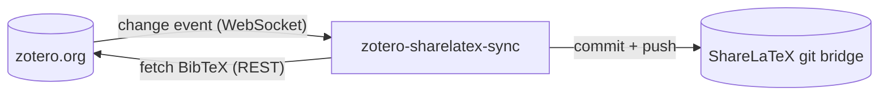

# zotero-sharelatex-sync

Keeps a `.bib` file in a ShareLaTeX/Overleaf project in sync with your Zotero library, through the
project's **git bridge**. It is meant for self-hosted ShareLaTeX instances where the built-in Zotero
integration is disabled.

- **Event-driven**: listens to Zotero's streaming API (WebSocket) and syncs within seconds of a
  change. It does not poll continuously; an hourly conditional check (`304 Not Modified` when
  nothing changed) is the only fallback.
- **Flexible selection**: the whole library, one collection, or one collection with all
  subcollections, from personal or group libraries. Output is BibTeX or BibLaTeX.
- **Clean output**: deterministic, sorted, and pushed only when the bibliography actually changed.
- **Secure**: secrets come from files (Docker/Kubernetes secrets) and are never logged, put in
  URLs, or written to disk. The container is non-root and works with a read-only root filesystem.
- **Self-healing**: retries with backoff, reconnects the WebSocket, uses a fresh clone for every
  push, and a watchdog restarts the process if anything gets stuck.
- **Verifiable**: multi-arch image on GHCR with SLSA provenance and SPDX SBOM attestations.



## Quick start

1. Create a **read-only** Zotero API key at <https://www.zotero.org/settings/keys>, and a git token
   in your ShareLaTeX account settings.
2. Save both as files:

   ```sh
   mkdir -p secrets
   # write the key/token into these two files, then:
   chmod 400 secrets/* && sudo chown 1000:1000 secrets/*
   #   secrets/zotero_api_key
   #   secrets/sharelatex_git_token
   ```

3. Create your settings file and adjust library ID, collection key and git URL:

   ```sh
   cp .env.example .env
   ```

4. Test once, then start the daemon ([compose.yaml](compose.yaml) reads `.env`):

   ```sh
   docker compose run --rm zotero-sharelatex-sync once   # test once
   docker compose up -d                                  # run the daemon
   ```

Kubernetes: see [deploy/kubernetes/deployment.yaml](deploy/kubernetes/deployment.yaml).

## Minimal configuration

| Variable | Example |
| --- | --- |
| `ZOTERO_LIBRARY_TYPE` | `user` (default) or `group` |
| `ZOTERO_LIBRARY_ID` | `1234567` |
| `ZOTERO_COLLECTION_KEY` | `ABCD2345` (omit for the whole library) |
| `ZOTERO_API_KEY_FILE` | `/run/secrets/zotero_api_key` |
| `SHARELATEX_GIT_URL` | `https://latex.example.edu/git/<project-id>` |
| `SHARELATEX_GIT_TOKEN_FILE` | `/run/secrets/sharelatex_git_token` |

Optional: `BIB_FORMAT` (`bibtex`/`biblatex`), `SHARELATEX_BIB_PATH` (`references.bib`),
`ZOTERO_INCLUDE_SUBCOLLECTIONS` (`true`), and more in
[docs/configuration.md](docs/configuration.md).

## Citation keys

The keys come from Zotero's own BibTeX/BibLaTeX export (e.g. `smith_deep_2020`); Better BibTeX is
not needed. To keep a key stable when you edit an item, put `Citation Key: yourKey` in the item's
**Extra** field. Details are in [docs/architecture.md](docs/architecture.md#citation-keys).

The generated `.bib` file is owned by the tool. Do not edit it in ShareLaTeX.

## Documentation

- [Architecture](docs/architecture.md): how it works, failure handling, security model
- [Configuration](docs/configuration.md): all environment variables and commands
- [Deployment](docs/deployment.md): credentials, Docker Compose, Kubernetes, image verification
- [Development](docs/development.md): local setup, tests, CI/CD

## Development

```sh
bun install
bun run check   # lint, typecheck, tests
```

## License

[MIT](LICENSE)
