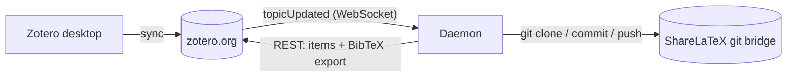

# Architecture

zotero-sharelatex-sync keeps one `.bib` file in a ShareLaTeX/Overleaf project in sync with a Zotero
library or collection. It is meant for instances where Overleaf's built-in Zotero integration is
unavailable but the **git bridge** works.

## Data flow

1. You edit references in Zotero (desktop or web). The desktop app syncs them to zotero.org.
2. zotero.org pushes a `topicUpdated` event over the
   [streaming API](https://www.zotero.org/support/dev/web_api/v3/streaming_api)
   (`wss://stream.zotero.org`) to the daemon. Zotero has no webhooks; this WebSocket is the only
   push mechanism.
3. The daemon debounces events (default 30 s, at most 5 min) so a burst of edits causes one sync.
4. A sync fetches the items from the [Web API](https://www.zotero.org/support/dev/web_api/v3/basics),
   builds a deterministic `.bib` file and, if it differs from the file in the project, commits and
   pushes it via the git bridge.

Polling happens only as a safety net: once per `SYNC_SAFETY_INTERVAL_SECONDS` (default 1 h) and
after every (re)connect of the stream, the daemon sends a conditional request
(`If-Modified-Since-Version`). Zotero answers `304 Not Modified` when nothing changed, so this is
nearly free. This also covers events that were missed while the WebSocket was disconnected.

## Components

| File | Responsibility |
| --- | --- |
| [src/index.ts](../src/index.ts) | Entrypoint and command dispatch: `daemon` (default), `once`, `healthcheck`, `git-credential` |
| [src/config.ts](../src/config.ts) | Reads and validates environment variables; `NAME_FILE` secret support |
| [src/app.ts](../src/app.ts) | Wires the daemon: scheduler, stream, safety timer, watchdog, signal handling |
| [src/zotero/client.ts](../src/zotero/client.ts) | REST client: paging, version checks, `Backoff`/`Retry-After`, retries |
| [src/zotero/stream.ts](../src/zotero/stream.ts) | Streaming API client with reconnect/backoff and handshake timeout |
| [src/zotero/collections.ts](../src/zotero/collections.ts) | Resolves a collection and its subcollections |
| [src/syncer.ts](../src/syncer.ts) | One sync: version check, fetch, build, publish |
| [src/bib.ts](../src/bib.ts) | Deterministic `.bib` generation (filtering, de-duplication, key collisions, sorting) |
| [src/scheduler.ts](../src/scheduler.ts) | Debounce, single-flight execution, retry with exponential backoff |
| [src/git.ts](../src/git.ts) | Fresh clone → write → commit → push, with a hardened git environment |
| [src/git-credential.ts](../src/git-credential.ts) | git credential helper that hands the token only to the configured host |
| [src/health.ts](../src/health.ts) | Liveness evaluation, health file, `healthcheck` command |
| [src/log.ts](../src/log.ts) | JSON-lines logging with secret redaction |

The service has **no runtime npm dependencies**: Bun provides `fetch`, `WebSocket`, process
spawning and hashing. The only system dependency is `git`.

## What gets exported

- **Selection**: the whole library (no `ZOTERO_COLLECTION_KEY`), one collection, or one collection
  plus all subcollections (`ZOTERO_INCLUDE_SUBCOLLECTIONS=true`, the default). Items that appear in
  several collections are written once. Trashed items and collections are ignored.
- **Item types**: top-level items only. Notes, attachments and annotations are skipped.
- **Format**: `BIB_FORMAT=bibtex` or `biblatex`. Zotero itself does the export (its built-in BibTeX
  and BibLaTeX translators) via `include=data,<format>` on the items endpoint.
- **Determinism**: entries are sorted by citation key and the file has a fixed header with no
  timestamp, so the same library state always produces byte-identical output. Unrelated library
  changes (e.g. editing a note) therefore do not produce commits.

### Citation keys

Better BibTeX is **not** used or needed. Zotero's translator generates keys from the author,
first title word and year (for example `smith_deep_2020`). Consequences:

- Changing an item's author, title or year changes its key, which breaks `\cite{...}` uses of the
  old key. To make a key permanent, add a line `Citation Key: myKey2020` to the item's **Extra**
  field. Zotero's translator is expected to use it; this has not yet been verified against the live
  API.
- Items are exported one at a time, so Zotero's own duplicate-key handling does not apply. The tool
  resolves collisions itself: the **oldest** item (by date added) keeps the key, later ones get
  `-2`, `-3`, … appended. Adding a new item therefore never renames an existing key. Collisions are
  logged as warnings.

## Writing to ShareLaTeX

Every publish starts from a **fresh clone** in a temporary directory (`WORK_DIR`, default `/tmp`)
that is deleted afterwards. There is no persistent working copy that could become corrupt or
diverge. The file is only committed if its content differs from what is in the project.

The tool owns the `.bib` file: manual edits made in ShareLaTeX are overwritten on the next sync that
changes the bibliography. They are not restored eagerly; the in-memory content hash suppresses
pushes until Zotero changes again or the daemon restarts.

If a push is rejected because a collaborator pushed in between, the publish is retried with a new
clone (up to 3 times), then the scheduler's backoff takes over.

## Self-healing

| Failure | Handling |
| --- | --- |
| Zotero API rate limit / 5xx / network error | Per-request retries honoring `Retry-After` and `Backoff` headers (Zotero requires this) |
| Library changes while paging | Snapshot rejected (`LibraryChangedError`), retried by the scheduler |
| Any sync failure | Scheduler retries with exponential backoff and jitter (30 s → 15 min) |
| WebSocket closed / errored / handshake hangs | Reconnect with exponential backoff using the server's `retry` hint; catch-up sync after every reconnect |
| Stream silently dead | Hourly safety check still syncs; watchdog restarts the process if the stream is down > 15 min |
| Syncs keep failing | Watchdog exits after `WATCHDOG_STALE_AFTER_SECONDS` without a successful check (default 3 h) |
| Event loop hangs | Health file is not refreshed; the `healthcheck` command fails, so Docker shows unhealthy and Kubernetes restarts the pod |
| git hangs | Every git process has a timeout and git aborts slow transfers (`http.lowSpeedLimit`) |
| Invalid configuration | Exit code 2 at startup with a clear message (a restart cannot fix it) |

Docker never restarts a container that is merely *unhealthy*. That is why the process itself exits
when the watchdog considers it unhealthy, and `restart: unless-stopped` (Compose) or the pod restart
policy (Kubernetes) brings it back.

## Security model

- **Secrets** come from `NAME_FILE` (Docker/Kubernetes secret mounts, preferred) or `NAME`. They are
  registered with the logger, which redacts them and any `user:pass@` URL credentials from every log
  line, including git error output.
- **Git credentials** never appear in the URL, in argv, in `.git/config` or on disk. git is
  configured through `GIT_CONFIG_*` environment variables to call `bun src/index.ts git-credential`,
  which returns the token only when git asks for the configured host over http(s).
- **git subprocesses** get an allow-listed environment (so the Zotero key is never passed to them),
  no system/global git config, no hooks, and `GIT_ALLOW_PROTOCOL=https` (plus `http` only if
  explicitly allowed).
- The Zotero key is sent only as the `Zotero-API-Key` header, or inside the TLS-protected WebSocket
  subscription message, never in a URL.
- The container runs as UID 1000 and works with a read-only root filesystem, all capabilities
  dropped, and `no-new-privileges`. It opens no ports.
- `SHARELATEX_BIB_PATH` is validated so it cannot escape the repository or touch `.git`.
